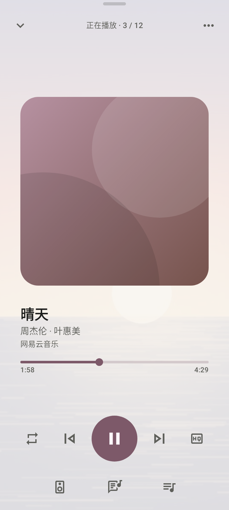
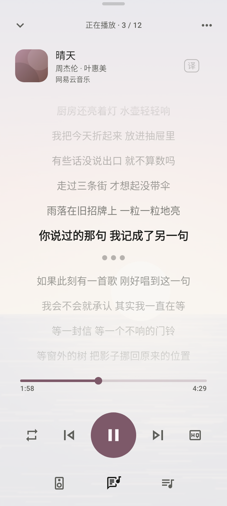
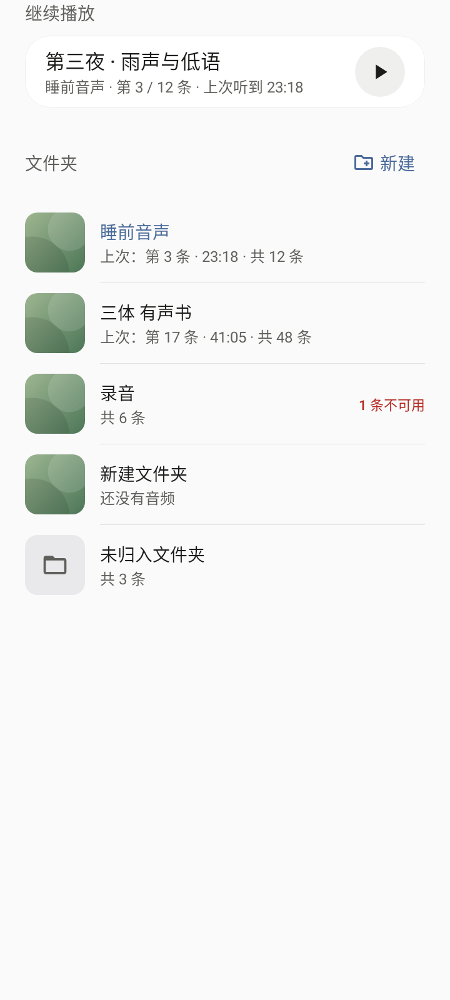

<p align="center">
  
</p>

<h1 align="center">Musxi Player Android</h1>

<p align="center">把三平台音乐和自己的音频，放进同一个播放器。</p>

<p align="center">
  <a href="https://github.com/qwt1011/Musxi-Player-Android/releases/latest"></a>
  <a href="https://github.com/qwt1011/Musxi-Player-Android/actions/workflows/android-verify.yml"></a>
  
  
  <a href="LICENSE"></a>
</p>

<p align="center">
  <a href="https://github.com/qwt1011/Musxi-Player-Android/releases/latest">下载安装包</a> ·
  <a href="docs/android-v0.3-release.md">v0.3 更新说明</a> ·
  <a href="docs/README.md">开发文档</a> ·
  <a href="https://github.com/qwt1011/Musxi-Player-Android/issues">反馈问题</a>
</p>

---

Musxi Player 的原生安卓版本，基于 [Miloscovo/Musxi-Player](https://github.com/Miloscovo/Musxi-Player) 持续开发。网易云音乐、QQ 音乐、酷狗与本地音频共用播放服务，在曲库、歌词和队列之间保持连贯的使用体验。

项目坚持“小而精”：平台请求在手机本地完成，无配套业务服务器；优先使用 Android 系统能力和现有播放器。平台音乐按账号、网络和版权条件播放，不下载或缓存平台音频；用户主动导入的本地副本独立保存。

## 可以做什么

- **三平台音乐**：连接账号，浏览曲库与歌单，搜索歌曲、查看推荐；保留原队列身份的手动／自动换源，音质以当前歌曲和账号实际可用档位为准。
- **自己的音频库**：导入音乐、音声、有声书和录音，选择复制或授权读取；使用文件夹与批量操作整理内容，检查来源或重新关联文件。
- **接着听下去**：本地音频播放进度、书签、按条目记忆倍速；支持提取视频声音，不播放视频画面。
- **读歌词**：原文与译文、支持字级时间的逐字高亮、手动匹配和字号设置；可选择让媒体卡片标题显示当前歌词。
- **换一种背景**：独立的界面壁纸与播放页壁纸，移动取景、缩放和强度调节；配合主题色、深色模式与按系统能力回退的玻璃效果。
- **控制播放**：随机／循环、分区队列与拖动、移除撤销、通知控制、输出选择，以及分钟／曲末定时停止。
- **直接更新**：应用内检查正式版本，核对安装包大小、SHA-256、包名、版本和签名后交给系统安装。

## 界面预览

| 播放页 | 歌词页 | 本地音频 |
| :---: | :---: | :---: |
|  |  |  |

以上由实际 Compose 页面使用合成数据生成，展示布局和外观，不含真实账号资料，也不替代实机验收。素材说明见 [预览来源](docs/media/readme/README.md)。

## 下载与安装

当前正式版本为 [Android v0.3](https://github.com/qwt1011/Musxi-Player-Android/releases/tag/v0.3.0)，应用版本 **0.3.0／versionCode 6**。支持 Android 8.0 / API 26 及以上。

在 [GitHub Releases](https://github.com/qwt1011/Musxi-Player-Android/releases/latest) 下载 `Musxi-Player-0.3.0.apk`，并取得 `SHA256SUMS.txt` 和应用内更新清单。沿用 v0.2 的正式包名 `tech.musxi.player` 与长期签名，可覆盖更新并保留应用数据。

开发包 `tech.musxi.player.dev` 与正式包可并存，账号、设置及队列独立保存，不能用正式包自动迁移开发包数据。具体变化及验证边界见 [v0.3 发布说明](docs/android-v0.3-release.md)。

当前仍在完善：其他 Android 版本、长时间后台、来电、不同文件提供方与更多音频设备需要继续验证。发布说明描述本版范围，源码和专项进展另见 [能力状态](docs/feature-status.md)。

## 构建与开发

需要 JDK 17、Android SDK 36、PowerShell 7，设置 `JAVA_HOME` 和 `ANDROID_HOME`。工具链为 Gradle 8.13、AGP 8.13.2、Kotlin 2.3.21。

```powershell
git clone https://github.com/qwt1011/Musxi-Player-Android.git
cd Musxi-Player-Android
pwsh -NoProfile -File scripts/verify.ps1
pwsh -NoProfile -File build.ps1 -Install
```

`verify.ps1` 编译主包和设备测试包，执行全部 JVM 测试与 Lint，记录对应源码和证据；不自动执行真实平台写入。`-Install` 覆盖安装开发包并打开应用，保留该包的数据。所有构建共用文件锁，详见 [验证工作流](docs/validation-workflow.md)；正式包使用仓库外密钥，见 [Release 构建](docs/release-build.md)。

| 模块 | 职责 |
| --- | --- |
| `app` | Compose 界面、应用装配、本地导入与 SQLite |
| `core` | 曲库、歌词、队列、本地音频与持久化策略 |
| `accounts` | 账号调度、登录、曲库与播放能力接口 |
| `playback` | Media3 服务、通知、播放与恢复 |
| `platform-kugou` / `platform-qq` / `platform-netease` | 三平台协议适配与原始许可 |

继续开发从 [当前接续](docs/next-session-handoff.md)、[能力状态](docs/feature-status.md) 和 [前端接口](docs/frontend-contract.md) 开始；工作规则见 [AGENTS.md](AGENTS.md)。临时材料与验收包放项目 `.local/`，不提交。

## 反馈与许可

欢迎在 [Issues](https://github.com/qwt1011/Musxi-Player-Android/issues) 反馈，附应用版本、手机型号、系统版本、操作步骤和实际现象；请先遮住账号、验证码及私人内容。

基于 Musxi Player，Copyright (c) 2026 Miloscovo and contributors，沿用 **GPL-3.0-or-later**。感谢原项目作者及所使用的开源项目；完整声明见 [LICENSE](LICENSE)、[第三方声明](THIRD_PARTY_NOTICES.md) 与模块随附许可。

README 展示结构参考 [Sibuxiangx/LoveACE](https://github.com/Sibuxiangx/LoveACE)，使用 Musxi 自有图标和页面素材。
